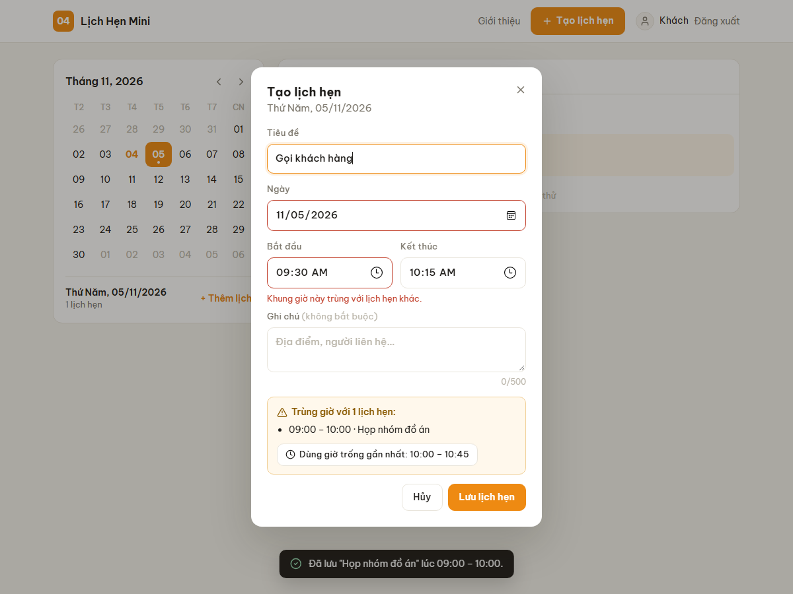
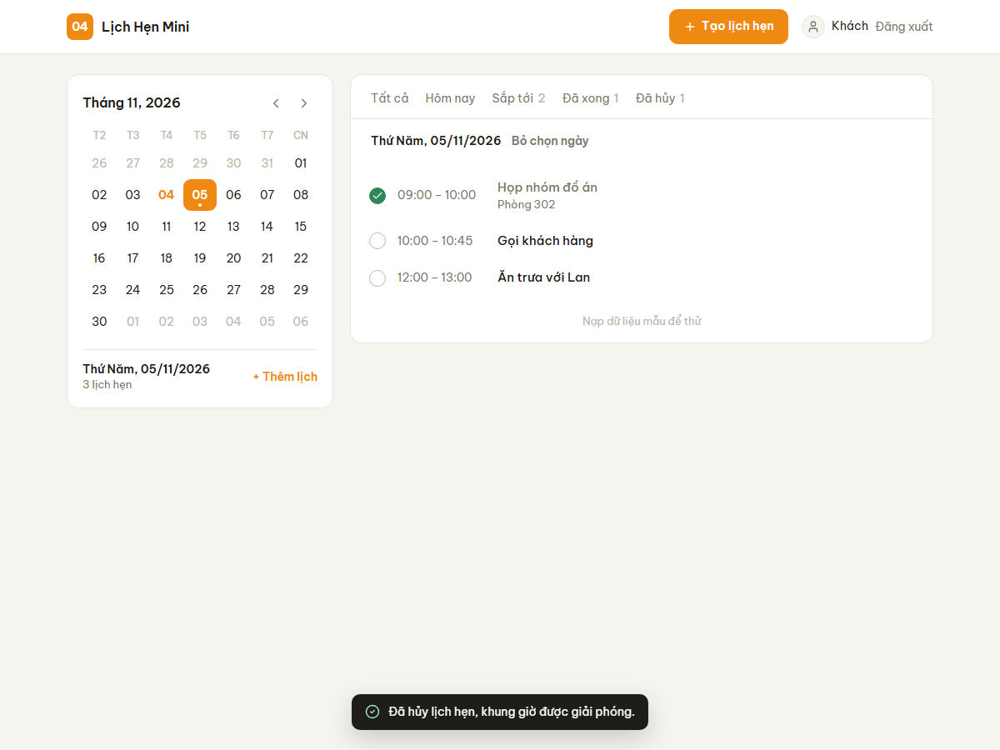
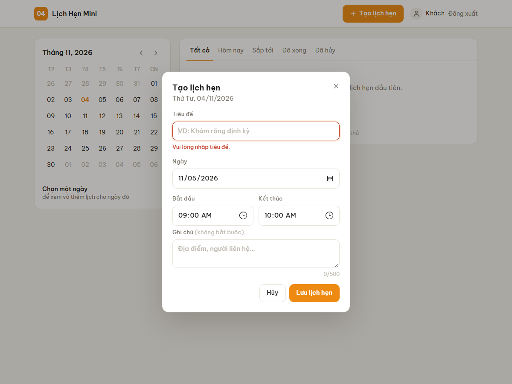
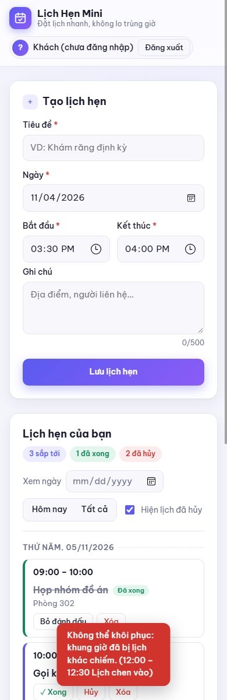
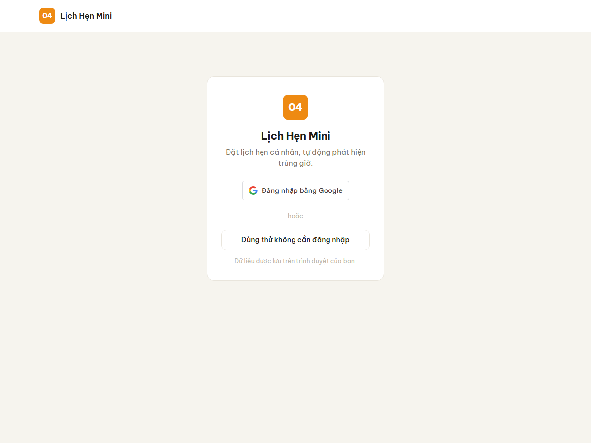
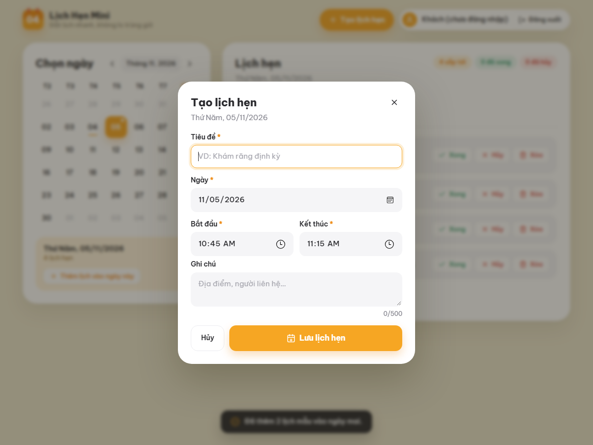
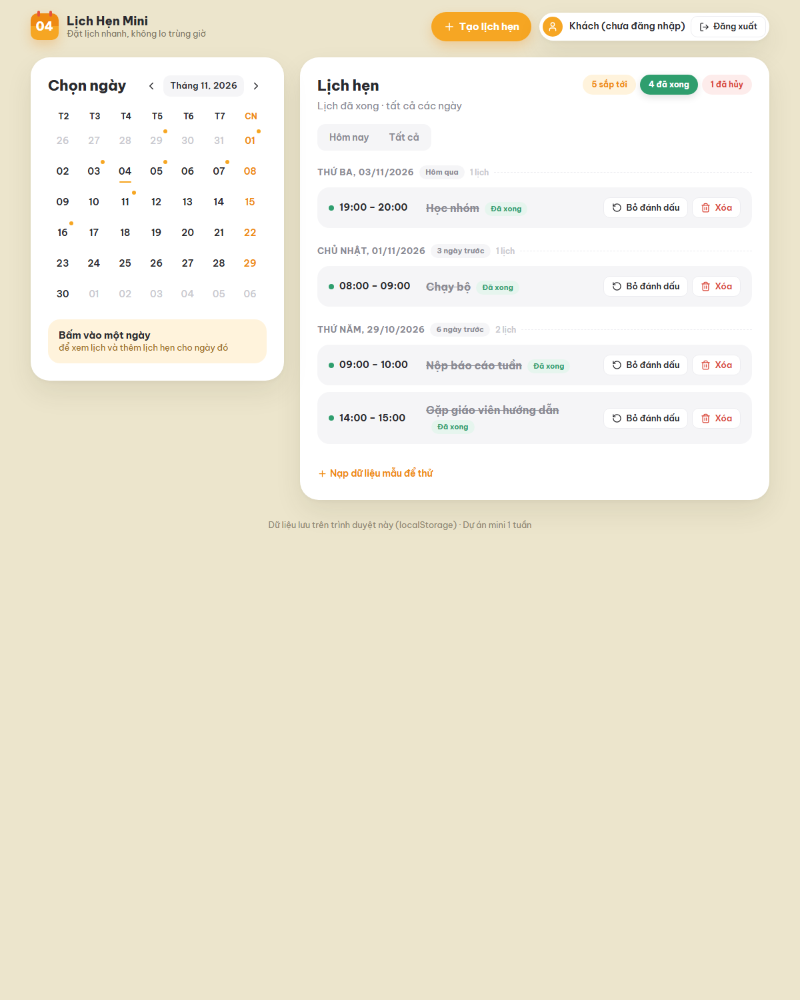
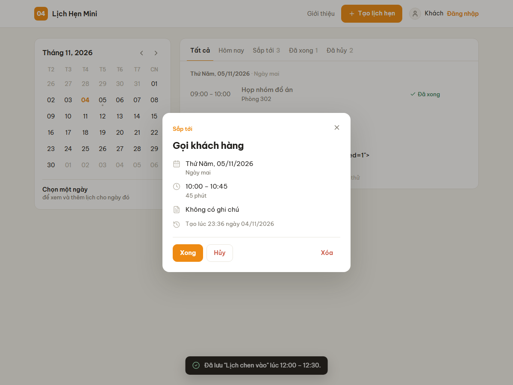

# 📅 Lịch Hẹn Mini

[](https://github.com/trucquynh0709/kits/actions/workflows/test.yml)

Website đặt và quản lý lịch hẹn cá nhân, **tự động chặn lịch trùng giờ và gợi ý khung giờ trống gần nhất**.

- 🔗 **Bản chạy thực tế:** https://kits-opal.vercel.app
- 🎬 **Video demo (1–2 phút):** `<dán link video>`, kịch bản ở [docs/DEMO_SCRIPT.md](docs/DEMO_SCRIPT.md)
- 💻 **Repository:** https://github.com/trucquynh0709/kits

---

## 1. Vấn đề cần giải quyết

Người dùng ghi lịch hẹn rải rác ở giấy note, tin nhắn, ứng dụng ghi chú, nên dễ **hẹn hai việc vào cùng một giờ** mà không biết cho tới khi quá muộn. Google Calendar thì quá nặng cho nhu cầu cá nhân đơn giản, và mặc định vẫn cho tạo sự kiện chồng giờ.

**Lịch Hẹn Mini** giải quyết đúng một việc: ghi lịch hẹn nhanh và **không cho phép hai lịch chồng lên nhau**. Khi bị trùng, app chỉ ra lịch nào đang chiếm giờ và đề xuất giờ trống gần nhất.

## 2. Mục tiêu và kết quả đạt được

| Mục tiêu (đề bài) | Kết quả | Minh chứng |
|---|---|---|
| Form tạo lịch: tiêu đề, ngày giờ, ghi chú | ✅ Có thêm **giờ kết thúc**, vì không có thời lượng thì không kiểm tra trùng được | [index.html](index.html) |
| Danh sách lịch hẹn theo ngày | ✅ Nhóm theo ngày, lọc theo ngày, nhãn "Hôm nay", ẩn/hiện lịch hủy | ảnh 03 |
| Đánh dấu đã xong / hủy | ✅ Thêm Khôi phục, Bỏ đánh dấu, Xóa | ảnh 03 |
| Kiểm tra trùng giờ | ✅ Chặn trùng, liệt kê và highlight lịch bị trùng, **gợi ý giờ trống** | ảnh 02 |
| Test case cho tạo lịch trùng | ✅ 13 unit test riêng cho tạo lịch trùng (tổng 52) + 37 e2e + 33 test thủ công | [docs/TEST_CASES.md](docs/TEST_CASES.md) |
| README + log công việc | ✅ | file này, [docs/DAILY_LOG.md](docs/DAILY_LOG.md) |
| Demo chức năng chính | ✅ Ảnh chụp bên dưới + video | [docs/screenshots/](docs/screenshots/) |
| Đăng nhập (khuyến nghị: social login) | ✅ **Đăng nhập Google**, mỗi tài khoản có dữ liệu riêng; có thêm chế độ khách | ảnh 00, [src/auth.js](src/auth.js) |
| Deploy miễn phí | ✅ Vercel, tự deploy mỗi lần push `main`; bộ e2e 37 case chạy pass trên bản thật | https://kits-opal.vercel.app |

## 3. Ảnh chụp màn hình

| Phát hiện trùng giờ + gợi ý | Danh sách theo ngày, trạng thái |
|---|---|
|  |  |
| **Validation** | **Mobile** |
|  |  |
| **Đăng nhập** | **Thêm lịch vào ngày đã chọn** |
|  |  |
| **Tab "Đã xong" trên nhiều ngày** | **Chi tiết lịch hẹn** |
|  |  |

## 4. Chức năng

0. **Đăng nhập bằng Google** (social login) hoặc **dùng thử không đăng nhập**. Mỗi tài khoản có danh sách lịch riêng, có avatar và nút đăng xuất.
1. **Tạo lịch hẹn** (action chính): nút **"Tạo lịch hẹn"** ở góc trên bên phải (trên điện thoại là nút nổi góc dưới) mở popup. Giờ mặc định là **khung trống 30 phút đầu tiên** trong ngày. Popup gồm tiêu đề (bắt buộc, ≤100 ký tự), ngày, giờ bắt đầu, giờ kết thúc, ghi chú (≤500 ký tự).
2. **Validation theo từng ô:** thiếu tiêu đề, ngày không tồn tại, giờ kết thúc ≤ giờ bắt đầu, lịch trong quá khứ, lịch dài quá 24h, ghi chú quá dài.
3. **Kiểm tra trùng giờ:**
   - Chặn lịch giao nhau với bất kỳ lịch *đang hoạt động* nào.
   - Lịch nối tiếp (09–10 rồi 10–11) **được phép**.
   - Lịch đã hủy hoặc đã xong **không chiếm giờ**.
   - Khi **khôi phục** một lịch đã hủy, app kiểm tra trùng lại.
4. **Gợi ý giờ trống gần nhất** có cùng độ dài, bấm một lần là form tự điền.
5. **Danh sách theo ngày:** sắp theo ngày và giờ. Một hàng tab lọc: **Tất cả · Hôm nay · Sắp tới · Đã xong · Đã hủy** (kèm số lượng). Lịch đã hủy chỉ nằm ở tab "Đã hủy" cho danh sách đỡ rối. Mỗi nhóm ngày có nhãn tương đối (*Ngày mai*, *Còn 3 ngày*, *6 ngày trước*) và số lịch; lịch sử (đã xong / đã hủy) xếp **mới nhất lên đầu**. Bấm tiêu đề ngày để nhảy tới ngày đó trên lịch.
6. **Chi tiết lịch hẹn:** bấm vào một lịch để mở popup thông tin: trạng thái (sắp tới / đang diễn ra / đã qua / đã xong / đã hủy), ngày kèm nhãn tương đối, giờ và thời lượng, ghi chú, thời điểm tạo. Trong popup có đủ thao tác: Xong, Hủy, Khôi phục, Bỏ đánh dấu, Xóa. Rê chuột vào một dòng sẽ hiện 2 nút nhanh: **✓ đánh dấu xong** (với lịch đã xong là ↺ bỏ đánh dấu) và **🗑 xóa**; trên điện thoại luôn hiện. Lịch đã xong hiển thị nhãn "✓ Đã xong" màu xanh thay vì ô tick, để không bị nhầm với checklist. Xóa luôn hỏi lại bằng **popup xác nhận của app**, không dùng hộp `confirm()` của trình duyệt.
7. **Lịch tháng** kiểu date picker: ngày có hẹn được đánh dấu chấm. Bấm một ngày để lọc danh sách; khung bên dưới có nút **"Thêm lịch vào ngày này"** (tự tắt với ngày đã qua).
8. Lưu tự động vào localStorage; giao diện sáng tông be/cam, responsive trên điện thoại.

### Thuật toán trùng giờ (tóm tắt)

Hai lịch `[s1, e1)` và `[s2, e2)` trùng nhau **khi và chỉ khi** `s1 < e2 && s2 < e1`. Một điều kiện này bao trọn 5 kiểu chồng giờ (trùng khít, chồng đầu, chồng cuối, nằm trong, bao ngoài), đồng thời cho phép lịch nối tiếp. Chi tiết và sơ đồ luồng ở [docs/DESIGN.md](docs/DESIGN.md#5-thuật-toán-kiểm-tra-trùng-giờ).

## 5. Cài đặt và chạy

Yêu cầu: **Node.js ≥ 20**. Project **không có dependency**, không cần `npm install`.

```bash
git clone https://github.com/trucquynh0709/kits.git
cd kits
npm start          # mở http://localhost:5173
npm test           # chạy 52 unit test
```

**Bật đăng nhập Google** (khoảng 5 phút; chưa bật thì app vẫn chạy ở chế độ khách):

1. Vào [Google Cloud Console › Credentials](https://console.cloud.google.com/apis/credentials). Tạo project nếu chưa có.
2. Nếu được hỏi, cấu hình *OAuth consent screen*: chọn External, điền tên app và email.
3. *Create credentials* → *OAuth client ID* → loại **Web application**.
4. Ở *Authorized JavaScript origins*, thêm `http://localhost` và `http://localhost:5173`, cùng domain deploy (ví dụ `https://xxx.vercel.app`).
5. Copy Client ID dán vào [src/config.js](src/config.js): `export const GOOGLE_CLIENT_ID = '....apps.googleusercontent.com';`

Client ID là thông tin công khai, commit lên repo không sao. Đây **không** phải client secret.

Chạy e2e trên trình duyệt thật (Edge/Chrome headless; script tự chụp lại ảnh vào `docs/screenshots/`):

```bash
npm start                      # terminal 1
node scripts/e2e-smoke.js      # terminal 2. Dùng Chrome: đặt biến BROWSER=<đường dẫn chrome.exe>
```

> Không có Node? Có thể mở trực tiếp bằng bất kỳ static server nào, ví dụ `python -m http.server`. Mở file `index.html` bằng `file://` sẽ không chạy vì trình duyệt chặn ES modules.

**Deploy (miễn phí):**

- **Vercel:** Import repo → Framework Preset: *Other* → bỏ trống Build Command → Deploy.
- **Netlify:** Add new site → Import from Git → bỏ trống Build command, Publish directory là `.` → Deploy.

## 6. Cấu trúc thư mục

```
lich-hen-mini/
├── index.html              # giao diện
├── css/style.css
├── src/
│   ├── scheduler.js        # ⭐ logic thuần: validate, trùng giờ, gợi ý, trạng thái
│   ├── calendar.js         # lưới lịch tháng, đếm lịch theo ngày
│   ├── icons.js            # icon SVG (bộ Lucide, ISC) nhúng sẵn
│   ├── auth.js             # đăng nhập Google (GIS), đọc/kiểm ID token, phiên đăng nhập
│   ├── config.js           # Google Client ID
│   ├── storage.js          # localStorage theo từng tài khoản (có chống dữ liệu hỏng)
│   └── app.js              # DOM, sự kiện, render
├── tests/
│   ├── scheduler.test.js   # 36 unit test logic lịch hẹn
│   ├── auth.test.js        # 9 unit test đăng nhập + tách dữ liệu
│   └── calendar.test.js    # 5 unit test lịch tháng
├── scripts/
│   ├── serve.js            # static server, không dependency
│   └── e2e-smoke.js        # e2e qua DevTools Protocol
├── docs/
│   ├── DESIGN.md           # phạm vi MVP, Use Case, Class, State, luồng trùng giờ
│   ├── diagrams/*.png
│   ├── DECISIONS.md        # quyết định kỹ thuật + đánh đổi
│   ├── PLAN.md             # WBS, Definition of Done, mốc thời gian
│   ├── DAILY_LOG.md        # nhật ký hằng ngày + nhật ký rủi ro
│   ├── TEST_CASES.md       # test case thủ công (pass/fail) + unit test
│   ├── DEMO_SCRIPT.md      # kịch bản video
│   └── screenshots/
└── .github/workflows/test.yml  # CI chạy unit test mỗi lần push
```

## 7. Quyết định kỹ thuật (tóm tắt)

- **JS thuần, không framework, không build:** app chỉ có 1 màn hình; bỏ được thời gian cấu hình, deploy static ở đâu cũng chạy.
- **localStorage thay vì SQLite/backend:** app dùng cá nhân trên một thiết bị, không cần server, chạy được offline. Lớp `storage.js` tách riêng để sau này dễ thay.
- **Tách logic thuần khỏi UI:** phần quan trọng nhất (trùng giờ) test được mà không cần trình duyệt, và hàm nhận `now` làm tham số nên test luôn cho cùng kết quả.
- **`node:test` thay vì Jest:** có sẵn trong Node, không cần cấu hình ES modules, 0 dependency.
- **Social login bằng Google Identity Services, không backend:** chỉ cần một Client ID; app đọc ID token ngay trên trình duyệt để biết người dùng là ai và tách dữ liệu theo tài khoản. Nhanh hơn nhiều so với dựng Firebase hay server riêng.

Đầy đủ 10 quyết định và đánh đổi ở [docs/DECISIONS.md](docs/DECISIONS.md).

## 8. Ngoài phạm vi

Những mục dưới đây **cố ý không làm** để luồng chính chạy trọn vẹn trong 1 tuần:

| Hạng mục | Lý do |
|---|---|
| Gửi email / thông báo nhắc hẹn | Đề bài ghi rõ không cần; cần backend và job hẹn giờ |
| Tích hợp Google Calendar | Đề bài ghi rõ không cần |
| Đồng bộ lịch theo tài khoản giữa nhiều máy | Đăng nhập hiện chỉ tách dữ liệu trên **cùng một trình duyệt**. Muốn đồng bộ thì cần backend (ví dụ Firestore). Xem rủi ro R1 |
| Kiểm chữ ký ID token phía server | Không có server. Hiện app kiểm `iss`/`aud`/`exp` phía client (xem D9) |
| Đăng nhập Facebook/GitHub | Một nhà cung cấp là đủ cho MVP |
| Sửa lịch hẹn đã tạo | Hiện làm bằng cách xóa rồi tạo lại. Logic đã sẵn sàng (`findConflicts` có `ignoreId`), chỉ thiếu UI |
| Lịch lặp lại (hằng tuần...) | Làm thuật toán trùng giờ phức tạp hơn nhiều |
| Chia sẻ lịch cho người khác | Cần backend |
| Chế độ xem lịch tháng/tuần dạng lưới | Danh sách theo ngày đã đáp ứng yêu cầu |
| Nhập lịch qua nửa đêm trên form | Logic **đã hỗ trợ** (có test TC-12), nhưng form chỉ có một ô ngày |

## 9. Hạn chế hiện tại

- Dữ liệu chỉ nằm trong trình duyệt đang dùng; xóa dữ liệu trình duyệt là mất. Chưa có xuất/nhập file.
- Đăng nhập Google chỉ dùng để nhận diện và tách dữ liệu, **không phải cơ chế bảo mật**: ai dùng chung máy vẫn đọc được localStorage qua DevTools. Phiên đăng nhập được nhớ cho tới khi bấm Đăng xuất.
- Đăng nhập Google chỉ chạy trên domain đã khai báo trong Google Console. Test e2e headless dùng chế độ khách; luồng Google cần kiểm thủ công.
- Không lưu múi giờ: nếu đổi múi giờ máy thì giờ hiển thị giữ nguyên theo giờ đã nhập.
- Không cho cố ý đặt chồng lịch, ví dụ hai việc có thể làm song song.
- Kiểm tra trùng là O(n) mỗi lần tạo; đủ nhanh cho vài nghìn lịch nhưng không tối ưu cho dữ liệu lớn.
- E2E script mặc định trỏ tới Edge trên Windows; dùng máy khác thì phải đặt biến `BROWSER`.

## 10. Tự đánh giá

**Điểm mạnh**
- Phần lõi (trùng giờ) được thiết kế có lý do rõ ràng: khoảng nửa mở, quy tắc lịch nào chiếm giờ. Mỗi quy tắc đều có test.
- Xử lý được một **case khó** dễ bỏ sót: khôi phục lịch đã hủy khi khung giờ đã bị chiếm (TC-30, E2E-14).
- Có thêm **gợi ý giờ trống**, nên app không chỉ báo lỗi mà còn giúp người dùng đặt được lịch.
- Có social login mà vẫn giữ được kiến trúc không backend, và dữ liệu cũ được chuyển sang tài khoản khách tự động.
- 3 lớp kiểm thử (52 unit, 37 e2e, 33 test thủ công, trong đó 3 case Google chờ test với Client ID thật), có CI. Project 0 dependency nên ai clone về cũng chạy được ngay.
- Phạm vi được quản lý chủ động: phần cắt đều có lý do, rủi ro được ghi lại.

**Điểm yếu**
- Chưa có sửa lịch, chưa có xuất/nhập dữ liệu.
- UI render lại toàn bộ danh sách mỗi lần thay đổi (chấp nhận được ở quy mô cá nhân).
- Chưa kiểm tra accessibility bằng công cụ chuyên dụng (đã có `aria-invalid`, `aria-live`, `role=alert`).

**Nếu có thêm 1 tuần**
1. Sửa lịch hẹn, kiểm tra trùng có loại trừ chính nó (logic đã sẵn).
2. Xuất/nhập JSON hoặc `.ics` để sao lưu.
3. Thêm Firestore (hoặc API + SQLite) để đồng bộ lịch theo tài khoản giữa nhiều thiết bị, kiểm chữ ký token phía server.
4. Chế độ xem tuần dạng lưới, kéo thả để đổi giờ.
5. Tùy chọn "vẫn lưu dù trùng" cho các việc làm song song.

## 11. Lessons Learned

- **Làm rõ đề trước khi code:** đề chỉ ghi "ngày giờ", nhưng muốn kiểm tra trùng thì phải có khoảng thời gian. Phát hiện điều này ngay ngày 1 nên tránh được việc phải làm lại.
- **Viết test cho trường hợp biên làm lộ lỗi thiết kế:** khi viết test chuyển trạng thái mới thấy lỗi khôi phục lịch gây trùng (R4).
- **`Date` của JavaScript dễ sai ngầm:** `new Date(2026, 1, 30)` không báo lỗi. Cần tự kiểm tra lại.
- **Đặt tính năng vào đúng chỗ thay vì thêm chỗ mới:** giao diện từng bị góp ý "rối mắt". Nguyên nhân không phải do thiếu trang trí mà do cùng một thao tác xuất hiện ở hai nơi (nút trên từng dòng và trong popup) và quá nhiều thứ được tô màu. Dồn thao tác vào popup chi tiết, gộp bộ lọc thành một hàng tab là đủ để màn hình dễ nhìn hơn hẳn.
- **Tìm giải pháp nhỏ hơn trước khi cắt:** ban đầu định cắt social login vì tưởng phải dựng backend (1,5–2 ngày). Xem lại thì Google Identity Services chạy được hoàn toàn phía client, chỉ mất khoảng nửa ngày, nên đã đưa lại vào phạm vi. Bài học: khi một tính năng có vẻ quá to, hãy tìm phiên bản tối thiểu của nó trước khi bỏ hẳn.

## 12. Tài liệu

[Thiết kế & sơ đồ](docs/DESIGN.md) · [Quyết định kỹ thuật](docs/DECISIONS.md) · [Kế hoạch WBS](docs/PLAN.md) · [Daily log & rủi ro](docs/DAILY_LOG.md) · [Test case](docs/TEST_CASES.md) · [Kịch bản demo](docs/DEMO_SCRIPT.md)
