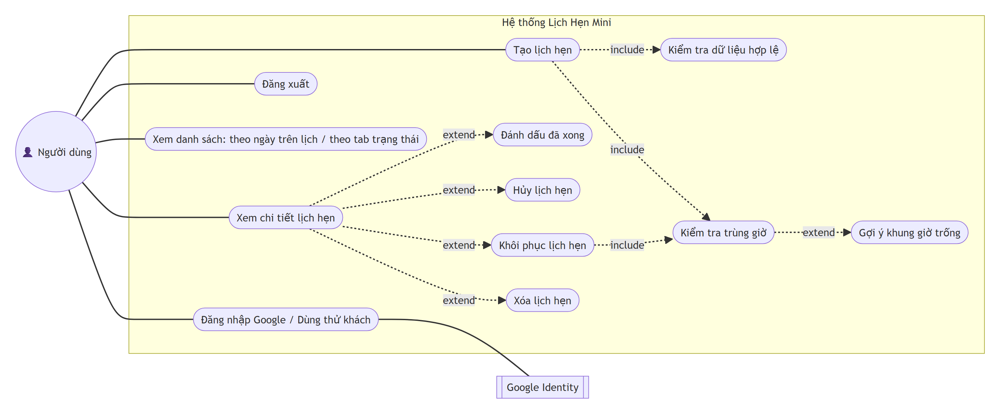
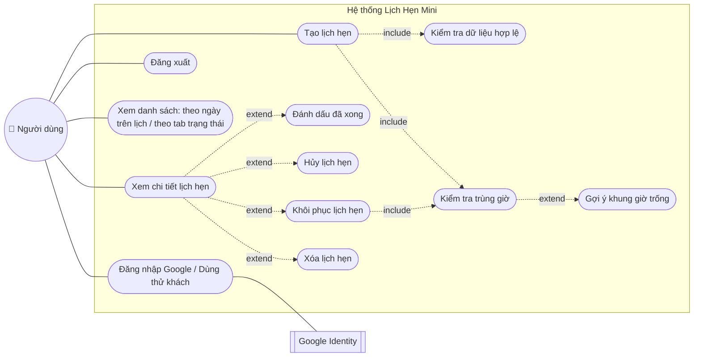
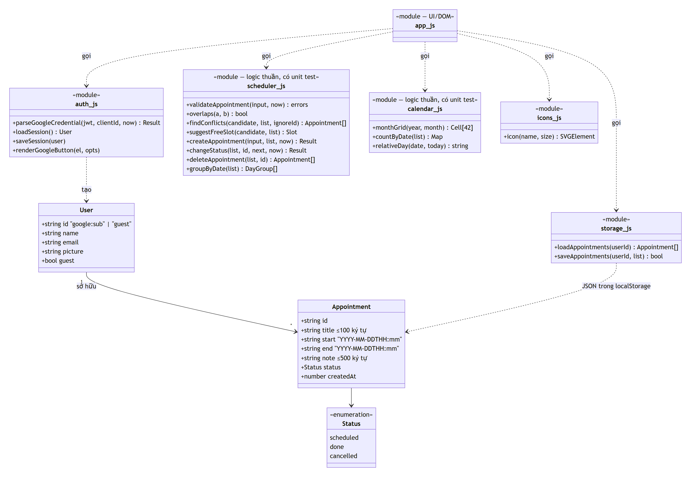
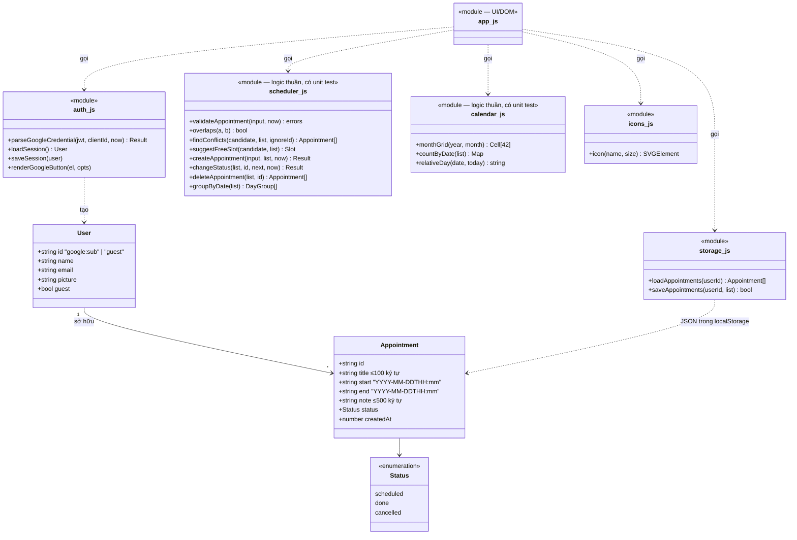
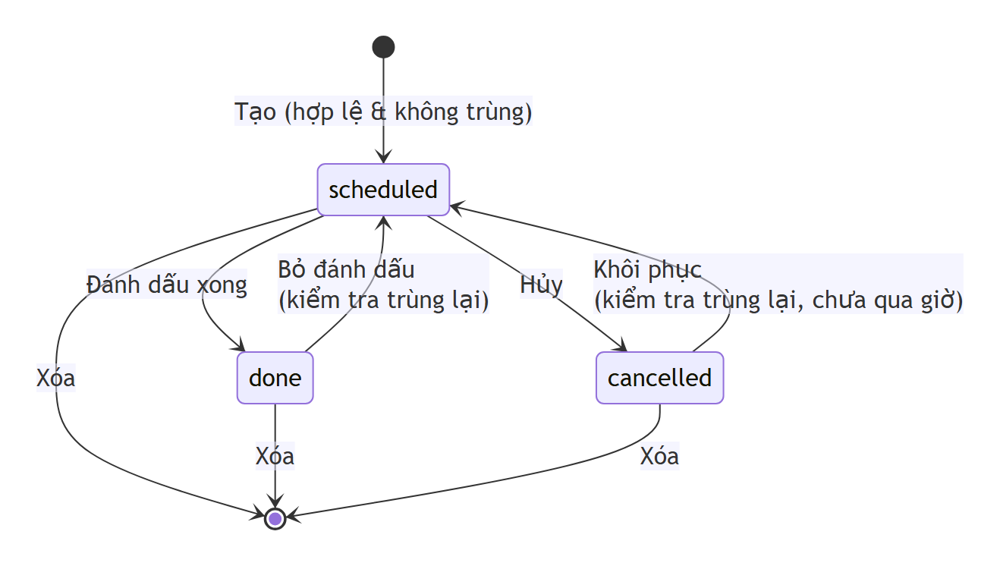
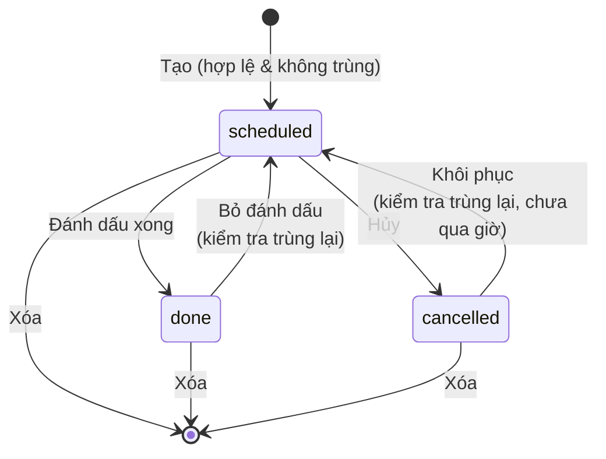
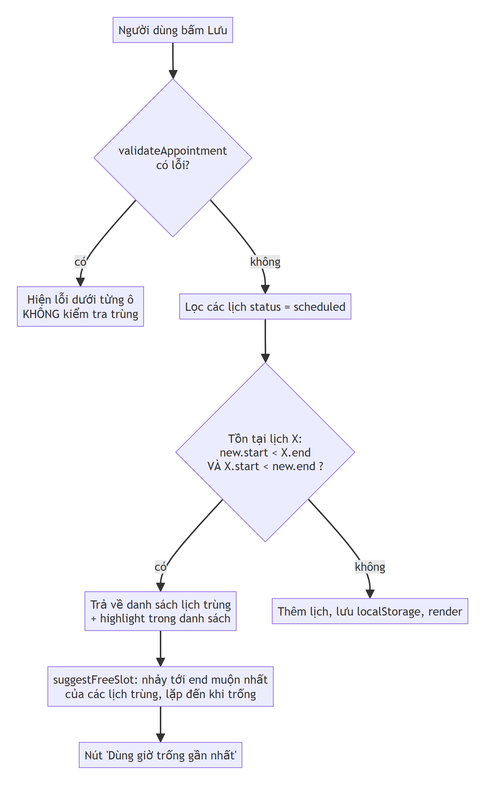
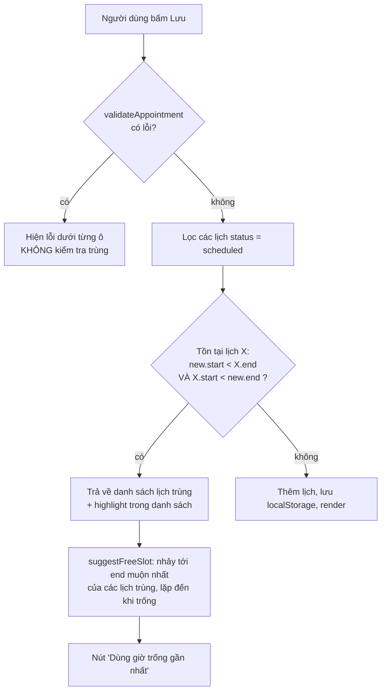

# Thiết kế — Lịch Hẹn Mini

Ảnh PNG của các sơ đồ nằm trong [`docs/diagrams/`](diagrams/). Mã nguồn sơ đồ (Mermaid) ở ngay dưới, GitHub tự hiển thị.

## 1. Phạm vi MVP và lý do chọn

Bài toán gốc là *"tạo lịch hẹn mà không bị chồng giờ"*. MVP chỉ giữ những gì cần để luồng đó chạy trọn vẹn:

| Giữ lại (trong MVP) | Lý do |
|---|---|
| Form tạo lịch: tiêu đề, ngày, giờ bắt đầu/kết thúc, ghi chú | Đầu vào bắt buộc của bài toán. Cần **giờ kết thúc** vì không có khoảng thời gian thì không thể kiểm tra trùng. |
| Validation + kiểm tra trùng giờ | Đây là phần "giải quyết vấn đề" của đề bài. |
| Danh sách nhóm theo ngày + lọc theo ngày | Người dùng cần thấy ngày nào đã kín. |
| Đánh dấu xong / hủy / khôi phục / xóa | Vòng đời tối thiểu của một lịch hẹn. |
| Lưu localStorage | Đủ cho dùng cá nhân, không cần server. |
| Đăng nhập Google (social login) + chế độ khách | Theo khuyến nghị của đề. Mỗi tài khoản có dữ liệu riêng; làm hoàn toàn phía trình duyệt nên vẫn không cần backend. |

Những thứ bị cắt có lý do ghi ở [README › Ngoài phạm vi](../README.md#ngoài-phạm-vi).

## 2. Sơ đồ Use Case

## 3. Sơ đồ lớp / dữ liệu

Có hai thực thể: `User`, lấy từ Google ID token hoặc là tài khoản khách, và `Appointment`. Mỗi `User` có nhiều `Appointment`, lưu trong localStorage dưới key `lich-hen-mini.v1:<user.id>`.

## 4. Vòng đời trạng thái

Chuyển `cancelled → done` bị chặn: một lịch đã hủy thì không thể "hoàn thành".

## 5. Thuật toán kiểm tra trùng giờ

**Điều kiện trùng:** hai khoảng nửa mở `[s1, e1)` và `[s2, e2)` giao nhau ⇔ `s1 < e2 && s2 < e1`.

- Một điều kiện duy nhất bao được cả 5 trường hợp: trùng khít, chồng đầu, chồng cuối, nằm trong, bao ngoài.
- Dùng khoảng **nửa mở** nên lịch nối tiếp (09:00–10:00 rồi 10:00–11:00) **không** tính là trùng.
- So sánh bằng timestamp đầy đủ (ngày + giờ) nên lịch qua nửa đêm (23:00–01:00) vẫn đúng.
- Độ phức tạp O(n) mỗi lần tạo, đủ cho vài nghìn lịch cá nhân.

**Các trường hợp khó đã xử lý:**

1. **Khôi phục lịch đã hủy.** Khi lịch A bị hủy, khung giờ của nó được giải phóng và người dùng có thể đặt lịch B vào đó. Nếu sau đó khôi phục A mà không kiểm tra thì hai lịch sẽ trùng nhau. `changeStatus` vì vậy chạy lại `findConflicts` mỗi khi đưa một lịch về `scheduled` (TC-30).
2. **Ngày không tồn tại.** `new Date(2026, 1, 30)` tự "lăn" sang 02/03. `toMs` so lại từng thành phần để từ chối 30/02 (TC-22).
3. **Gợi ý qua chuỗi lịch liền nhau.** Nhảy một bước là chưa đủ, vì slot mới có thể đụng tiếp lịch kế bên. Thuật toán lặp đến khi tìm được chỗ trống (TC-15).
4. **Dữ liệu bản cũ khi thêm đăng nhập.** Bản đầu tiên lưu mọi lịch vào một key chung. Khi thêm đăng nhập, `storage.js` tự chuyển dữ liệu đó sang tài khoản khách để người dùng cũ không mất lịch (AU-08).
